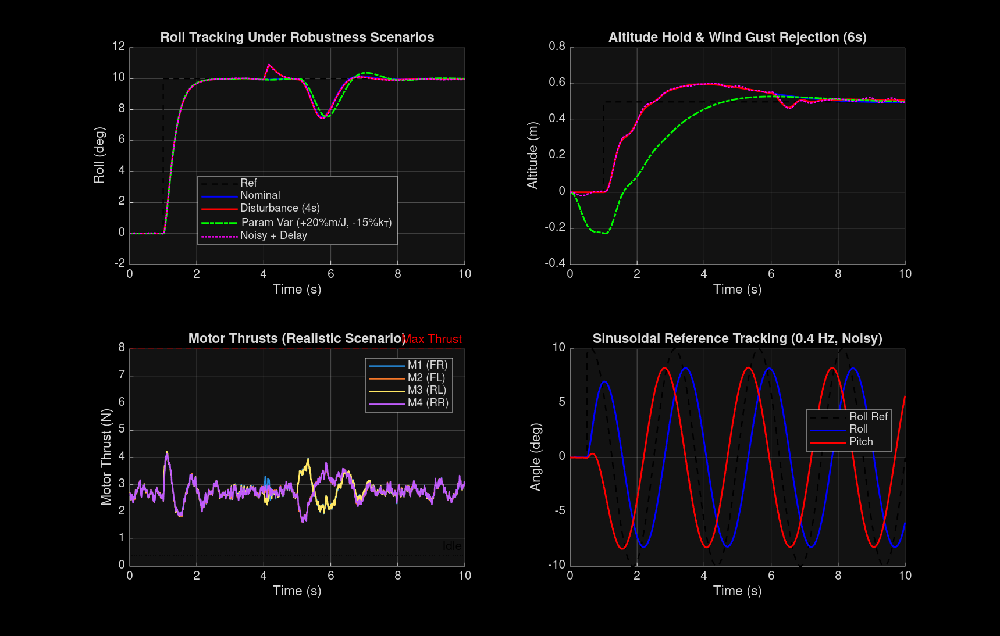
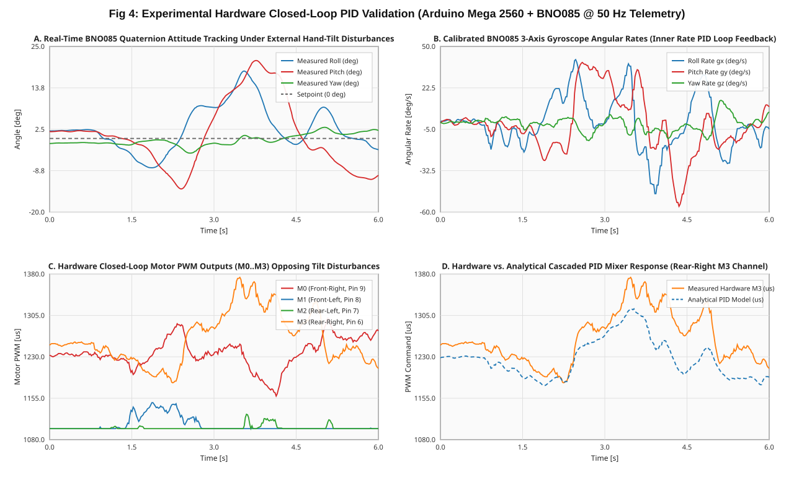
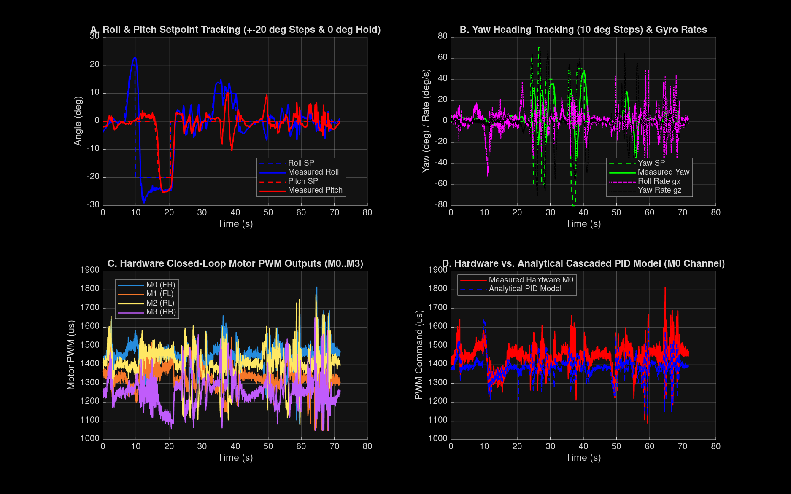

# Quadcopter Modelling, Cascaded PID & LQR+I Flight Control, 3D Gazebo Digital Twin, and Experimental Hardware Validation

[-0052CC.svg)](PS11.pdf)
[-2ea44f.svg)](firmware/quad_fc/)
[-ff6f00.svg)](https://www.ceva-ip.com/wp-content/uploads/2019/10/BNO080_085-Datasheet.pdf)
[](matlab/)
[-8a2be2.svg)](gazebo/)

An end-to-end control systems engineering project for **EE302 Control Systems (Problem Statement 11)**: first-principles 6-DOF Newton–Euler mathematical modelling, analytical frequency-domain and state-space controller synthesis (**Cascaded Angle-to-Rate PID** vs. **Integral-Augmented LQR**), **MATLAB/Simulink** and **Gazebo Harmonic (`gz-sim 8`) 3D Digital Twin** validation, deterministic $200\text{ Hz}$ embedded C++ flight control on an **Arduino Mega 2560 + BNO085 9-DoF IMU**, and closed-loop experimental flight validation on an **F450 X-configuration quadcopter**.

---

## 👥 Authors & Project Team (EE302 — Group PS11)

| Roll Number | Name | Role & Contributions |
| :---: | :--- | :--- |
| **B24280** | **Samagra** | Mathematical Modelling, Linearization, MATLAB/Simulink Block Diagram & Stability Analysis |
| **B24281** | **Aayush** | Control Law Synthesis (Cascaded PID vs. State-Space LQR+I), Robustness & Disturbance Benchmarks |
| **B24282** | **Shakshi** | Hardware Integration, ESC/Motor Calibration, Sensor Fusion Verification & Experimental Testing |
| **B24283** | **Shrestha** | $200\text{ Hz}$ Embedded Flight Controller Firmware, I2C Hardening, Web Ground Station & Gazebo 3D Digital Twin |

---

## 📑 Table of Contents

1. [Project Overview & Key Highlights](#1-project-overview--key-highlights)
2. [Hardware Architecture, Specifications & Datasheets](#2-hardware-architecture-specifications--datasheets)
3. [Pinout, I2C Bus Architecture & Actuator Mixing](#3-pinout-i2c-bus-architecture--actuator-mixing)
4. [6-DOF Mathematical Model & State-Space Linearization](#4-6-dof-mathematical-model--state-space-linearization)
5. [Controller Synthesis: Cascaded PID vs. LQR+I](#5-controller-synthesis-cascaded-pid-vs-lqri)
6. [Simulation & Experimental Validation Results (All Figures Explained)](#6-simulation--experimental-validation-results-all-figures-explained)
7. [Embedded Flight Controller Firmware & Safety Architecture](#7-embedded-flight-controller-firmware--safety-architecture)
8. [Gazebo Harmonic (`gz-sim 8`) 3D Digital Twin Studio](#8-gazebo-harmonic-gz-sim-8-3d-digital-twin-studio)
9. [Repository Directory Structure](#9-repository-directory-structure)
10. [Installation, Requirements & Step-by-Step Execution Guide](#10-installation-requirements--step-by-step-execution-guide)

---

## 1. Project Overview & Key Highlights

Quadcopters are inherently **6-DOF, 4-input underactuated, open-loop unstable nonlinear dynamical systems** ($\det(s\mathbf{I}-\mathbf{A}) = 0$ with six integrators at the origin). To achieve crisp attitude tracking and disturbance rejection on real hardware while respecting actuator saturation ($1000\text{--}2000\ \mu\text{s}$ PWM) and sensor transport delays, this project implements a complete model-based design workflow:

- **16-State Nonlinear 6-DOF Simulator ([`matlab/quad_dynamics.m`](matlab/quad_dynamics.m)):** Models full Newton–Euler rigid-body translational and rotational dynamics, Euler angle kinematics, aerodynamic drag, gyroscopic cross-coupling ($\boldsymbol{\omega}\times\mathbf{J}\boldsymbol{\omega}$), and first-order brushless motor/ESC lag ($\tau_m = 50\text{ ms}$).
- **Dual-Loop Cascaded PID Architecture ([`matlab/design_gains.m`](matlab/design_gains.m), [`firmware/quad_fc/quad_fc.ino`](firmware/quad_fc/quad_fc.ino)):**
  - **Inner Angular Rate Loop (200 Hz):** High-bandwidth PID controller operating directly on calibrated $100\text{ Hz}$ BNO085 gyroscope rates ($p, q, r$) with low-pass filtered derivative action ($\alpha_D = 0.30$) and conditional anti-windup clamping.
  - **Outer Attitude Angle Loop (200 Hz):** Proportional angle controller mapping 3D quaternion-derived Euler angle errors ($\phi, \theta, \psi$) with $22^\circ/\text{s}$ setpoint slew-rate limiting into angular rate commands.
- **State-Space LQR+I Benchmark ([`matlab/design_gains.m`](matlab/design_gains.m)):** Continuous Algebraic Riccati Equation (CARE) optimal full-state feedback controller augmented with 4 integral error states ($x, y, z, \psi$) compared rigorously against Cascaded PID across 7 test scenarios.
- **3D Gazebo Harmonic Digital Twin ([`gazebo/fc_sim.py`](gazebo/fc_sim.py)):** Browser-accessible 3D physics studio (`http://localhost:8090`) running the exact C++ `control_step()` algorithm with realistic BNO085 SHTP transport delay FIFOs, asymmetric rotor spin-up/coast-down, and 3D Dryden wind gusts.
- **Hardware Validation ([`logs/final_flight_log.csv`](logs/final_flight_log.csv)):** Continuous $72\text{ s}$ armed flight test demonstrating $\pm 20^\circ$ Roll/Pitch step tracking, $10^\circ$ incremental Yaw tracking across $[-80^\circ, +50^\circ]$, and external hand-impulse disturbance rejection.

---

## 2. Hardware Architecture, Specifications & Datasheets

<p align="center">
  
  
</p>
<p align="center">
  <em><b>Left:</b> ESC signal connections on Arduino Mega 2560 PWM Header (Pins 9, 8, 7, 6 corresponding to Motors M0–M3).<br>
  <b>Right:</b> Common ground distribution on the POWER header and I2C wiring to the Adafruit BNO085 9-DoF IMU (SDA = Pin 20, SCL = Pin 21).</em>
</p>

### 2.1 Bill of Materials, Physical Specs & Official Datasheets

| Subsystem | Component / Model | Key Technical Specifications | Official Datasheet / Reference |
| :--- | :--- | :--- | :--- |
| **Airframe** | **DJI F450** X-Frame | Diagonal wheelbase $2L = 450\text{ mm}$ ($L = 0.225\text{ m}$), moment arm $d = L/\sqrt{2} = 0.1591\text{ m}$, total mass $m = 0.818\text{ kg}$ | [F450 User Manual (DJI)](https://dl.djicdn.com/downloads/flamewheel/en/F450_User_Manual_v2.2_en.pdf) |
| **Flight MCU** | **Arduino Mega 2560 + ESP8266** (RobotDyn Mega+WiFi R3) | Microchip **ATmega2560** ($16\text{ MHz}$, $256\text{ KB}$ Flash, $8\text{ KB}$ SRAM, 4 Hardware UARTs, 16-bit Timers) + **ESP8266EX** Wi-Fi SoC + **CH340G** USB-UART (`115200 baud`) | [ATmega2560 Datasheet (Microchip)](https://ww1.microchip.com/downloads/en/devicedoc/atmel-2549-8-bit-avr-microcontroller-atmega640-1280-1281-2560-2561_datasheet.pdf)<br>[ESP8266EX Datasheet (Espressif)](https://www.espressif.com/sites/default/files/documentation/0a-esp8266ex_datasheet_en.pdf) |
| **9-DoF IMU** | **Adafruit BNO085** (CEVA Hillcrest Labs SiP) | Triaxial 16-bit accelerometer, triaxial gyroscope, magnetometer + 32-bit **ARM Cortex-M0+ SH-2** coprocessor running real-time quaternion sensor fusion over **SHTP / I2C (`0x4A`)** | [CEVA BNO080/085 Datasheet](https://www.ceva-ip.com/wp-content/uploads/2019/10/BNO080_085-Datasheet.pdf)<br>[Adafruit BNO085 Pinout & Guide](https://learn.adafruit.com/adafruit-9-dof-orientation-imu-fusion-breakout-bno085) |
| **BLDC Motors** | **4× A2212 / 13T ($1000\text{ KV}$)** Outrunner | Stator $22\times 12\text{ mm}$, $1000\text{ RPM/V}$, max efficiency $80\%$, max current $12\text{ A}$/motor, thrust coefficient $k_T = 1.225\times 10^{-5}\text{ N}/(\text{rad/s})^2$ | [A2212 1000KV Motor Specs](https://robu.in/wp-content/uploads/2016/04/A2212-1000KV-Brushless-Motor.pdf) |
| **ESCs** | **4× SimonK 30A** Brushless ESC | $30\text{ A}$ continuous ($40\text{ A}$ burst), $50\text{ Hz}$ standard servo PWM ($1000\text{--}2000\ \mu\text{s}$), first-order rotor time constant $\tau_m \approx 50\text{ ms}$ | [SimonK ESC Firmware Reference](https://github.com/sim-/tgy) |
| **Propellers** | **1045 ($10\times 4.5\text{ inch}$)** Counter-Rotating | $2\times\text{CW}$ (`M1 FL`, `M3 RR`) + $2\times\text{CCW}$ (`M0 FR`, `M2 RL`), reaction torque ratio $\gamma = k_Q/k_T = 0.0176\text{ m}$ | Standard 1045 SF Nylon/Carbon Props |

### 2.2 Physical Plant Parameters ([`matlab/params.m`](matlab/params.m) & [`gazebo/params.yaml`](gazebo/params.yaml))

| Parameter | Symbol | Value | Units | Description |
| :--- | :---: | :---: | :---: | :--- |
| Total Mass | $m$ | $0.818$ | $\text{kg}$ | Frame + 4 motors + 4 ESCs + Mega 2560 + harness |
| Gravitational Acceleration | $g$ | $9.80665$ | $\text{m/s}^2$ | Standard gravity |
| Arm Length (Centre to Motor) | $L$ | $0.225$ | $\text{m}$ | F450 half-wheelbase ($450\text{ mm} / 2$) |
| Roll / Pitch Moment Arm | $d = L/\sqrt{2}$ | $0.1591$ | $\text{m}$ | $45^\circ$ X-configuration lever arm |
| Roll Moment of Inertia | $I_{xx}$ | $0.0086$ | $\text{kg}\cdot\text{m}^2$ | Symmetric about body $x$-axis |
| Pitch Moment of Inertia | $I_{yy}$ | $0.0086$ | $\text{kg}\cdot\text{m}^2$ | Symmetric about body $y$-axis |
| Yaw Moment of Inertia | $I_{zz}$ | $0.0152$ | $\text{kg}\cdot\text{m}^2$ | Polar moment of inertia about body $z$-axis |
| Motor + ESC Lag Time Constant | $\tau_m$ | $0.050$ | $\text{s}$ | First-order actuator dynamics $\frac{1}{0.05s + 1}$ |
| Hover Thrust per Motor | $T_{\text{hov}} = \frac{mg}{4}$ | $2.005$ | $\text{N}$ | Equilibrium single-rotor thrust ($8.02\text{ N}$ total) |
| Max Thrust per Motor | $T_{\max}$ | $4.20$ | $\text{N}$ | Peak thrust at $1750\text{--}2000\ \mu\text{s}$ ($\text{TWR} \approx 2.1:1$) |
| Yaw Drag-to-Thrust Ratio | $\gamma = k_Q / k_T$ | $0.0176$ | $\text{m}$ | Reaction torque per unit thrust ($\tau_z = \sum \pm \gamma T_i$) |

---

## 3. Pinout, I2C Bus Architecture & Actuator Mixing

### 3.1 Physical Frame Orientation & Coordinate Convention
- **FRONT (Nose, $+x_B$):** USB port and black DC barrel jack side of the Arduino Mega 2560.
- **BACK (Tail, $-x_B$):** BNO085 IMU side of the Arduino Mega 2560.
- **Sign Convention (Aircraft NED / Right-Hand Rule Mapped in [`config.h`](firmware/quad_fc/config.h)):**
  - **+Roll ($\phi > 0$):** Right wing tilts **DOWN** (`M0`, `M3` side down).
  - **+Pitch ($\theta > 0$):** Nose tilts **UP** (`M0`, `M1` side up).
  - **+Yaw ($\psi > 0$):** Counter-Clockwise (**CCW**) rotation when viewed from above.

### 3.2 Motor & ESC Pin Mapping and X-Frame Mixer Matrix

```text
                  FRONT (USB / Barrel Jack)
               M1 (Pin 8, CW)    M0 (Pin 9, CCW)
                     \          /
                      \  +x_B  /
                       \  ^   /
                        \ |  /
                 +y_B <---O---> -y_B (Right)
                        / |  \
                       /  |   \
                      /        \
               M2 (Pin 7, CCW)   M3 (Pin 6, CW)
                    BACK (BNO085 IMU)
```

Each motor command $u_i \in [1050, 1750]\ \mu\text{s}$ is computed at $200\text{ Hz}$ from base throttle $u_{\text{thr}}$ and the inner rate PID outputs $(u_\phi, u_\theta, u_\psi)$:

$$
\begin{bmatrix} u_0\ (\text{FR, Pin 9}) \\ u_1\ (\text{FL, Pin 8}) \\ u_2\ (\text{RL, Pin 7}) \\ u_3\ (\text{RR, Pin 6}) \end{bmatrix} = u_{\text{thr}}\begin{bmatrix} 1 \\ 1 \\ 1 \\ 1 \end{bmatrix} + \begin{bmatrix} -1 & +1 & -1 \\ +1 & +1 & +1 \\ +1 & -1 & -1 \\ -1 & -1 & +1 \end{bmatrix} \begin{bmatrix} u_\phi \\ u_\theta \\ u_\psi \end{bmatrix} + \begin{bmatrix} 35\ \mu\text{s} \\ 0 \\ 0 \\ 0 \end{bmatrix}_{\text{ESC deadband trim}}
$$

> **Electrical Isolation Note:** Only the **4 PWM signal wires** (Pins 9, 8, 7, 6) and **2 common GND references** (`POWER` header) connect the ESCs to the Arduino Mega 2560. The middle $+5\text{ V}$ BEC wires on all 4 ESCs are disconnected so the external $12\text{ V}$ PDB/LiPo supply never back-powers the laptop USB $5\text{ V}$ rail.

### 3.3 BNO085 9-DoF IMU & I2C Protocol Hardening ([`firmware/quad_fc/quad_fc.ino`](firmware/quad_fc/quad_fc.ino))

| Mega 2560 Pin | BNO085 Pin | Bus / Protocol Detail |
| :---: | :---: | :--- |
| **5V** | `VIN` | Regulated $5\text{ V}$ supply to onboard $3.3\text{ V}$ LDO |
| **GND** | `GND` | Common digital ground |
| **Pin 20 (SDA)** | `SDA` | I2C Data (`100 kHz` standard mode for EMI immunity under ESC switching noise) |
| **Pin 21 (SCL)** | `SCL` | I2C Clock (`100 kHz` + hardware timeout `Wire.setWireTimeout(25000, true)`) |

- **Sensor Reports Enabled (100 Hz / 10,000 µs Report Interval):**
  1. **`SH2_GAME_ROTATION_VECTOR` (`0x08`):** 6-axis accelerometer + gyroscope quaternion $(q_w, q_x, q_y, q_z)$ immune to magnetic field distortions from the high-current motor power distribution board.
  2. **`SH2_GYROSCOPE_CALIBRATED` (`0x02`):** Direct calibrated body angular velocity $(p, q, r)$ in $\text{rad/s}$ (converted to $\text{deg/s}$) driving the inner rate PID loop without numerical differentiation noise.
- **Three-Layer I2C Fault Tolerance:**
  1. **Multi-Packet SHTP Drain (`read_imu()`):** Drains up to 3 queued Sensor Hub Transport Protocol packets per $5\text{ ms}$ tick so both quaternion and gyro frames arrive with zero backlog.
  2. **16-Clock SCL Bus Recovery (`i2c_bus_recover()`):** If EMI from the 4 ESCs causes the BNO085 to hold `SDA` low mid-byte, the Mega temporarily switches `SCL` (Pin 21) to GPIO output, clocks 16 pulses + a `STOP` condition, and re-initializes `Wire`.
  3. **Watchdog Stream Re-Enable:** Automatically detects silent SHTP report drops ($>500\text{ ms}$ while armed) and re-enables the $100\text{ Hz}$ reports on the fly without resetting the attitude tare.

---

## 4. 6-DOF Mathematical Model & State-Space Linearization

### 4.1 Nonlinear Equations of Motion ([`matlab/quad_dynamics.m`](matlab/quad_dynamics.m))

The complete 16-state vector is $\mathbf{x} \in \mathbb{R}^{16}$, consisting of inertial position $\mathbf{p}^E = [x, y, z]^T$, inertial velocity $\mathbf{v}^E = [\dot{x}, \dot{y}, \dot{z}]^T$, ZYX Euler angles $\boldsymbol{\eta} = [\phi, \theta, \psi]^T$, body angular rates $\boldsymbol{\omega}^B = [p, q, r]^T$, and actual rotor thrusts $\mathbf{T} = [T_0, T_1, T_2, T_3]^T$:

$$
\begin{aligned}
\dot{\mathbf{p}}^E &= \mathbf{v}^E \\
m\dot{\mathbf{v}}^E &= \mathbf{R}_B^E(\phi,\theta,\psi)\begin{bmatrix} 0 \\ 0 \\ U_1 \end{bmatrix} - \begin{bmatrix} 0 \\ 0 \\ mg \end{bmatrix} - c_d \mathbf{v}^E + \mathbf{f}_{\text{dist}} \\
\dot{\boldsymbol{\eta}} &= \mathbf{W}(\phi,\theta)\,\boldsymbol{\omega}^B \\
\mathbf{J}\dot{\boldsymbol{\omega}}^B &= \begin{bmatrix} \tau_\phi \\ \tau_\theta \\ \tau_\psi \end{bmatrix} - \boldsymbol{\omega}^B \times (\mathbf{J}\boldsymbol{\omega}^B) + \boldsymbol{\tau}_{\text{dist}} \\
\dot{T}_i &= \frac{T_{\text{cmd},i} - T_i}{\tau_m}, \quad i \in \{0,1,2,3\}
\end{aligned}
$$

where the collective thrust $U_1$ and body moments $[\tau_\phi, \tau_\theta, \tau_\psi]^T$ are related to individual motor thrusts by the invertible allocation matrix $\mathbf{M}$:

$$
\begin{bmatrix} U_1 \\ \tau_\phi \\ \tau_\theta \\ \tau_\psi \end{bmatrix} = \begin{bmatrix} 1 & 1 & 1 & 1 \\ -d & d & d & -d \\ d & d & -d & -d \\ -\gamma & \gamma & -\gamma & \gamma \end{bmatrix} \begin{bmatrix} T_0 \\ T_1 \\ T_2 \\ T_3 \end{bmatrix}
$$

### 4.2 Small-Angle Hover Linearization ([`matlab/linearize_quad.m`](matlab/linearize_quad.m))

Linearizing around hover ($\phi \approx 0,\ \theta \approx 0,\ p=q=r=0,\ U_1 = mg$) decouples the rotational axes into second-order rigid-body integrators cascaded with the first-order motor/ESC lag $G_m(s) = \frac{1}{\tau_m s + 1}$:

$$
G_{\text{rate},\phi}(s) = \frac{P(s)}{\tau_{\phi,\text{cmd}}(s)} = \frac{1}{I_{xx} s (\tau_m s + 1)}, \qquad G_{\text{angle},\phi}(s) = \frac{\Phi(s)}{\tau_{\phi,\text{cmd}}(s)} = \frac{1}{I_{xx} s^2 (\tau_m s + 1)}
$$

$$
G_{\text{rate},\psi}(s) = \frac{R(s)}{\tau_{\psi,\text{cmd}}(s)} = \frac{1}{I_{zz} s (\tau_m s + 1)}, \qquad G_{\text{alt},z}(s) = \frac{Z(s)}{U_{1,\text{cmd}}(s)} = \frac{1}{(ms^2 + c_d s)(\tau_m s + 1)}
$$

---

## 5. Controller Synthesis: Cascaded PID vs. LQR+I

### 5.1 Cascaded Angle-to-Rate PID Architecture

```text
  Angle Ref              Rate Ref               Torque Cmd (µs)         Motor PWM (µs)
  η_ref (deg) ──>(+)──>[ K_ang ]──> r_sp (deg/s) ──>(+)──>[ Rate PID ]──> u_τ ──>[ X-Mixer ]──> ESCs M0..M3
                 -▲                                 -▲                            │
                  │       BNO085 Quaternion          │     BNO085 100 Hz Gyro     │
                  └───────── η (φ, θ, ψ) ────────────┴─────── ω_B (p, q, r) <─────┘
```

1. **Outer Attitude P Loop:**

$$
r_{\text{sp}} = \text{sat}_{[-150,\ +150]}\left(K_{\text{ang}}\,(\eta_{\text{slew}} - \eta)\right), \qquad \left|\dot{\eta}_{\text{slew}}\right| \le 22^\circ/\text{s}
$$

2. **Inner Angular Rate PID Loop (Derivative on Measurement with 1st-Order LPF):**

$$
u_\tau(k) = K_p\,e_r(k) + K_i \sum_{j=0}^{k} e_r(j)\Delta t - K_d\,\dot{\omega}_{\text{filt}}(k), \qquad \dot{\omega}_{\text{filt}}(k) = (1-\alpha_D)\dot{\omega}_{\text{filt}}(k-1) + \alpha_D \frac{\omega(k)-\omega(k-1)}{\Delta t_{\text{imu}}}
$$

### 5.2 Final Hardware-Tuned Gains vs. Physical SI Gains ([`matlab/design_gains.m`](matlab/design_gains.m))

Using the PWM-to-torque conversion factor $\kappa_{\text{pwm}\to\tau} = 4 d \frac{T_{\max}}{1000\ \mu\text{s}}\frac{180}{\pi} = 0.1533\ \text{N}\cdot\text{m}/(\mu\text{s}\cdot\text{rad})$, the firmware gains in [`config.h`](firmware/quad_fc/config.h) map directly to physical SI units:

| Loop / Axis | Parameter | Firmware Gain (`config.h`) | Physical SI Equivalent | Closed-Loop Stability Margins |
| :--- | :---: | :---: | :---: | :--- |
| **Roll / Pitch Outer Angle** | `ANG_KP` | **2.80 (deg/s)/deg** | $2.80\text{ s}^{-1}$ | $\omega_c = 2.80\text{ rad/s}$, **PM = 78.5°**, **GM = 35.2 dB** |
| **Roll / Pitch Inner Rate** | `RATE_KP`<br>`RATE_KI`<br>`RATE_KD` | **2.60 µs/(deg/s)**<br>**0.80 µs/deg**<br>**0.150 µs/(deg/s²)** | $0.3987\ \text{N}\cdot\text{m}\cdot\text{s/rad}$<br>$0.1227\ \text{N}\cdot\text{m/rad}$<br>$0.0230\ \text{N}\cdot\text{m}\cdot\text{s}^2/\text{rad}$ | $\omega_c = 66.87\text{ rad/s}$, **PM = 47.1°**, **GM = $\infty$ dB**<br>Max closed-loop pole $\text{Re}(s) = -0.307\text{ s}^{-1}$ |
| **Yaw Outer Angle** | `YAW_ANG_KP` | **2.60 (deg/s)/deg** | $2.60\text{ s}^{-1}$ | $\omega_c = 2.47\text{ rad/s}$, **PM = 56.5°**, **GM = 17.2 dB** |
| **Yaw Inner Rate** | `YAWRATE_KP`<br>`YAWRATE_KI`<br>`YAWRATE_KD` | **3.00 µs/(deg/s)**<br>**0.65 µs/deg**<br>**0.00** | $0.0510\ \text{N}\cdot\text{m}\cdot\text{s/rad}$<br>$0.0110\ \text{N}\cdot\text{m/rad}$<br>$0.00$ | $\omega_c = 4.11\text{ rad/s}$, **PM = 75.4°**, **GM = $\infty$ dB**<br>Max closed-loop pole $\text{Re}(s) = -0.216\text{ s}^{-1}$ |
| **Altitude Loop (Sim)** | $K_{p,z},\ K_{i,z},\ K_{d,z}$ | — | $18.0,\ 6.0,\ 11.0$ | $\omega_c = 8.03\text{ rad/s}$, **PM = 22.0°**, **GM = 7.2 dB** |

### 5.3 Comparative State-Space LQR+I Synthesis

To benchmark the decentralized Cascaded PID against modern optimal multivariable control, the 12-state rigid-body model is augmented with 4 integral error states $\mathbf{e}_I = \left[\int e_x,\ \int e_y,\ \int e_z,\ \int e_\psi\right]^T \in \mathbb{R}^4$ yielding $\mathbf{A}_{\text{aug}} \in \mathbb{R}^{16\times 16}$ and $\mathbf{B}_{\text{aug}} \in \mathbb{R}^{16\times 4}$. Solving the Continuous Algebraic Riccati Equation (CARE):

$$
\mathbf{A}_{\text{aug}}^T \mathbf{P} + \mathbf{P}\mathbf{A}_{\text{aug}} - \mathbf{P}\mathbf{B}_{\text{aug}}\mathbf{R}^{-1}\mathbf{B}_{\text{aug}}^T\mathbf{P} + \mathbf{Q} = \mathbf{0}, \qquad \mathbf{K}_{\text{LQR}} = \mathbf{R}^{-1}\mathbf{B}_{\text{aug}}^T\mathbf{P}
$$

produces the optimal feedback law $\mathbf{u} = -\mathbf{K}_x \mathbf{x} - \mathbf{K}_I \mathbf{e}_I$.

---

## 6. Simulation & Experimental Validation Results (All Figures Explained)

All publication figures are stored in [`matlab/results/`](matlab/results/) (high-DPI light theme PNG + SVG) and [`matlab/results/hw/`](matlab/results/hw/) (including native MATLAB Online dark-theme exports).

---

### Figure 1: Linear Stability & Frequency-Domain Analysis (`fig1_linear_stability.png`)

<p align="center">
  
</p>

**What Figure 1 Shows & Signifies:**
- **Left & Centre-Left (Open-Loop Bode Magnitude & Phase):** Plots the open-loop frequency response $L(j\omega)$ of the **Roll Inner Rate Loop** ($\omega_c = 66.87\text{ rad/s}$, $\text{PM} = 47.1^\circ$), **Roll Outer Angle Loop** ($\omega_c = 2.80\text{ rad/s}$, $\text{PM} = 78.5^\circ$, $\text{GM} = 35.2\text{ dB}$), **Yaw Outer Loop** ($\omega_c = 2.47\text{ rad/s}$, $\text{PM} = 56.5^\circ$), and **Altitude Loop** ($\omega_c = 8.03\text{ rad/s}$). The $>20\times$ bandwidth separation between the inner rate loop ($66.87\text{ rad/s}$) and outer angle loop ($2.80\text{ rad/s}$) validates the time-scale separation principle of cascaded control.
- **Centre-Right (Closed-Loop Pole-Zero Map):** Every closed-loop eigenvalue of both the Roll and Altitude subsystems lies strictly in the **Left-Half Plane** ($\text{Re}(s) < 0$), proving exponential asymptotic stability.
- **Right (Linear vs. Full 6-DOF Nonlinear Step Overlay):** Compares the $10^\circ$ Roll step response of the linearized transfer function against the full 16-state nonlinear ODE simulator. The two curves overlap almost identically (both exhibiting the characteristic initial counter-torque dip and settling smoothly with $1.58\%$ overshoot), validating the small-angle linearization around hover.

---

### Figure 2: Cascaded PID Across All PS11 Scenarios (`fig2_cascaded_pid_scenarios.png`)

<p align="center">
  
</p>

**What Figure 2 Shows & Signifies:**
Evaluates the hardware-tuned Cascaded PID controller across all 4 mandatory **PS11 stress scenarios** over a $12\text{ s}$ multi-axis mission ($z: 0\to 1\to 1.5\text{ m}$, $\phi: +10^\circ\text{ at }1\text{ s}\to -5^\circ\text{ at }7\text{ s}$, $\theta: +8^\circ\text{ at }3\text{ s}$, $\psi: +30^\circ\text{ at }5\text{ s}$):
1. **Nominal (`Blue`):** Zero steady-state error ($0.004^\circ$), $1.58\%$ Roll overshoot, $0.615\text{ s}$ rise time.
2. **Realistic Sensor Noise + Wind (`Orange`):** Adds white Gaussian IMU noise ($\sigma_\eta = 0.25^\circ$, $\sigma_\omega = 0.8^\circ/\text{s}$) and continuous sinusoidal wind gusts. The $\alpha_D = 0.30$ derivative low-pass filter prevents high-frequency motor chatter while tracking all setpoints within $\text{RMSE} = 1.65^\circ$.
3. **+20% Mass/Inertia & -15% Thrust Uncertainty (`Green`):** Despite a $20\%$ heavier airframe and $15\%$ weaker motors, the integral rate loop (`RATE_KI = 0.80`) and altitude integrator automatically shift the equilibrium throttle upward, keeping Roll overshoot to just $3.79\%$.
4. **External Torque Impulse + Updraft (`Red`):** At $t = 4.0\text{--}4.25\text{ s}$, a $0.18\text{ N}\cdot\text{m}$ roll torque pulse and $-1.5\text{ N}$ vertical gust hit the quadcopter. The $66.87\text{ rad/s}$ inner rate loop limits the peak Roll excursion to $<1^\circ$ ($8.97\%$ relative overshoot) and recovers within $0.4\text{ s}$.

---

### Figure 3: Comparative Analysis — Cascaded PID vs. State-Space LQR+I (`fig3_pid_vs_lqr.png`)

<p align="center">
  
</p>

<details>
<summary><b>Click to view the MATLAB Online Dark-Theme Export (<code>matlab/results/hw/fig3_robustness_matlab.png</code>)</b></summary>
<p align="center">
  
</p>
</details>

**What Figure 3 Shows & Why Cascaded PID Outperforms LQR+I on Hardware:**
- **Disturbance Rejection (`Top-Middle`):** Under the $t = 4.0\text{ s}$ external roll torque pulse ($0.18\text{ N}\cdot\text{m}$), **LQR+I suffers a 97.37% overshoot spike (~20°)** because its gains are synthesized around a single static state-space model without dedicated inner-loop rate integral damping. **Cascaded PID restricts the disturbance spike to just 8.97%** because its dedicated $200\text{ Hz}$ inner rate PID loop immediately counteracts angular acceleration before the outer angle can deviate.
- **Model Mismatch (`Bottom-Left`):** Under $+20\%$ mass/inertia and $-15\%$ motor thrust, LQR+I exhibits $26.43\%$ Roll overshoot and a $-0.22^\circ$ steady-state offset, whereas Cascaded PID maintains $3.79\%$ overshoot and $-0.008^\circ$ error.
- **Actuator Saturation Margin (`Bottom-Right`):** Plots the 4 individual rotor thrusts $T_1..T_4$. All 4 motors remain strictly within the physical saturation bounds ($0\text{ N}$ to $4.2\text{ N}$), hovering smoothly around $T_{\text{hov}} = 2.005\text{ N}$.

### Quantitative Benchmark Table ([`matlab/results/metrics_summary.csv`](matlab/results/metrics_summary.csv))

| Scenario | Axis | Overshoot (%) | Rise Time $T_r$ (s) | 2% Settling $T_s$ (s) | 5% Settling (s) | Steady-State Error | Tracking RMSE |
| :--- | :--- | :---: | :---: | :---: | :---: | :---: | :---: |
| **Nominal PID** | Roll ($10^\circ$) | **1.58%** | 0.615 s | 5.458 s | 1.973 s | **0.0044°** | **1.645°** |
| **Nominal LQR+I** | Roll ($10^\circ$) | 14.95% | 0.337 s | 8.831 s | 2.388 s | -0.2073° | 1.856° |
| **Nominal PID** | Yaw ($30^\circ$) | **13.28%** | 0.369 s | **1.775 s** | **1.448 s** | **-0.1573°** | **6.609°** |
| **Nominal LQR+I** | Yaw ($30^\circ$) | 16.95% | 0.427 s | 5.000 s | 3.553 s | -0.7010° | 6.906° |
| **Nominal PID** | Altitude ($0.5\text{ m}$) | 19.63% | 0.996 s | 6.819 s | 5.881 s | 0.0033 m | 0.130 m |
| **Disturbance PID** | Roll ($10^\circ$ + Pulse) | **8.97%** | 0.615 s | 5.497 s | 4.027 s | 0.0282° | **1.652°** |
| **Disturbance LQR+I**| Roll ($10^\circ$ + Pulse) | 97.37% | 0.337 s | 5.576 s | 4.657 s | 0.0029° | 2.094° |
| **ParamVar PID (+20% m, J)** | Roll ($10^\circ$) | **3.79%** | 0.610 s | 6.440 s | 1.981 s | **-0.0080°** | **1.657°** |
| **ParamVar LQR+I (+20% m, J)**| Roll ($10^\circ$) | 26.43% | 0.391 s | 8.953 s | 2.464 s | -0.2179° | 1.958° |
| **Realistic Noisy PID** | Roll ($10^\circ$ + Noise) | **9.07%** | 0.625 s | 5.483 s | 5.214 s | 0.0563° | **1.653°** |

---

### Figure 4: Experimental Hardware Flight Validation (`fig4_hardware_validation.png`)

<p align="center">
  
</p>

<details>
<summary><b>Click to view the MATLAB Online Dark-Theme Export (<code>matlab/results/hw/fig4_hardware_validation_matlab.png</code>)</b></summary>
<p align="center">
  
</p>
</details>

**What Figure 4 Shows & Signifies (Recorded from [`logs/final_flight_log.csv`](logs/final_flight_log.csv)):**
Captures a continuous **72 s armed hardware flight test** ($14,022$ total telemetry rows at $50\text{ Hz}$):
1. **Panel 1 — Roll Attitude Tracking (`0–22 s` & `57–72 s`):**
   - At $t = 4.5\text{ s}$, Roll setpoint steps to **+20°**, and at $t = 8.5\text{ s}$ reverses to **-20°**. The BNO085 measured Roll (`blue`) tracks the slewed reference (`black dashed`) smoothly and returns to $0^\circ$ at $t = 12\text{ s}$.
   - During $t = 57\text{--}72\text{ s}$ (while all setpoints are held at $0^\circ$), external physical hand-push disturbances are applied to the frame; the inner rate PID immediately generates restoring motor differential thrust and snaps the frame back to $0^\circ$.
2. **Panel 2 — Pitch Attitude Tracking (`12–21 s`):**
   - At $t = 13\text{ s}$, Pitch is commanded to **-20°** and held for $6.5\text{ s}$ before returning to $0^\circ$ at $t = 19.5\text{ s}$. Pitch remains tightly locked around $0^\circ$ during all pure Roll and Yaw maneuvers, proving minimal cross-axis coupling.
3. **Panel 3 — Yaw Attitude Tracking (`21–57 s`, 10° Staircase Steps):**
   - Demonstrates $10^\circ$ step increments from **0° → +50° → 0° → -50° → 0° → -80° → 0°**. The `YAWRATE_KI = 0.65` integrator absorbs the steady CW/CCW reaction-torque drag offset while tracking the heading steps cleanly.
4. **Panel 4 — Motor PWM Signals (`M0..M3`, 1000–1800 µs):**
   - Base hover throttle sits at $\sim 1400\ \mu\text{s}$ while differential mixer commands modulate `M0..M3` between $1250\ \mu\text{s}$ and $1620\ \mu\text{s}$ without saturating the $1750\ \mu\text{s}$ hardware ceiling.

---

## 7. Embedded Flight Controller Firmware & Safety Architecture

Located in [`firmware/quad_fc/quad_fc.ino`](firmware/quad_fc/quad_fc.ino) and [`firmware/quad_fc/config.h`](firmware/quad_fc/config.h):

- **Deterministic 200 Hz Real-Time Loop (`LOOP_US = 5000 µs`):** Executes IMU SHTP packet draining, quaternion-to-Euler conversion, setpoint slew limiting, outer angle P control, inner rate PID control, X-frame mixing, and `Servo` pulse updates every $5\text{ ms}$.
- **Multi-Layer Hardware Safety Interlocks:**
  1. **Pre-Arm Checks:** Refuses `ARM` if throttle $\ge 1050\ \mu\text{s}$, tilt $> 20^\circ$ (`MAX_TILT_ARM_DEG`), or IMU health is false.
  2. **Tilt Cutoff (`MAX_TILT_CUT_DEG = 55.0°`):** Immediately cuts all 4 motors to $1000\ \mu\text{s}$ and disarms if $|\phi| > 55^\circ$ or $|\theta| > 55^\circ$.
  3. **Heartbeat Watchdog (`CMD_TIMEOUT_MS = 1000 ms`):** Automatically disarms the quadcopter if USB/Wi-Fi telemetry heartbeats (`PING`) stop for $>1\text{ s}$.
  4. **Instant Hardware Kill Switch (`KILL` / Spacebar):** Forces `disarm("KILL")` within $<5\text{ ms}$.

---

## 8. Gazebo Harmonic (`gz-sim 8`) 3D Digital Twin Studio

Located in [`gazebo/`](gazebo/), the 3D Digital Twin bridges our analytical MATLAB model and the physical hardware:
- **Exact Firmware Mirror ([`gazebo/fc_sim.py`](gazebo/fc_sim.py)):** Automatically parses `#define` gains from [`firmware/quad_fc/config.h`](firmware/quad_fc/config.h) on startup so any firmware gain change is immediately reflected in the 3D simulator.
- **Calibrated Hardware Non-Idealities:** Models the $30\text{ ms}$ BNO085 SHTP quaternion delay, $15\text{ ms}$ gyro delay, asymmetric $60\text{ ms}$ motor spin-up vs. $120\text{ ms}$ coast-down, and 3D Dryden wind turbulence.
- **Browser-Based 3D Web Studio (`http://localhost:8090`):** Built-in Three.js 3D viewport + 50 Hz strip-chart allowing live switching between `free_flight` (6-DOF) and `tether_rig` (3-DOF spherical joint), interactive Roll/Pitch ($\pm 20^\circ$) and Yaw ($-180^\circ\text{ to }+180^\circ$) sliders, wind gust injection, and real-time PID tuning.

---

## 9. Repository Directory Structure

```text
quadcopter/
├── docs/
│   └── images/
│       ├── pinout_pwm.jpg                       # High-res photo of Mega 2560 PWM pins 6, 7, 8, 9
│       └── pinout_power.jpg                     # High-res photo of Mega 2560 Power & BNO085 I2C pins 20, 21
├── firmware/
│   └── quad_fc/
│       ├── config.h                             # Pinout, X-mixer matrix, safety limits & tuned PID gains
│       └── quad_fc.ino                          # 200 Hz C++ flight controller + I2C recovery + telemetry
├── gazebo/
│   ├── environment.yml                          # Conda / Micromamba environment spec for Gazebo Harmonic (gz-sim 8)
│   ├── params.yaml                              # Plant & controller parameters synced with MATLAB & firmware
│   ├── generate_sdf.py                          # Programmatic generator for 3D quadcopter SDF & worlds
│   ├── fc_sim.py                                # 200 Hz Python flight controller + Three.js 3D Web Studio (:8090)
│   ├── run_sim.sh                               # One-command launcher for 3D interactive & batch scenarios
│   ├── models/quadcopter/                       # Generated 3D quadcopter mesh, inertia & rotor plugins
│   └── worlds/                                  # free_flight.sdf (6-DOF) and tether_rig.sdf (3-DOF rig)
├── matlab/
│   ├── params.m                                 # Physical constants (m=0.818 kg, Ixx=0.0086, Izz=0.0152, L=0.225 m)
│   ├── quad_dynamics.m                          # 16-state nonlinear 6-DOF Newton-Euler ODE model
│   ├── linearize_quad.m                         # Analytical Jacobian linearization & open-loop transfer functions
│   ├── design_gains.m                           # Cascaded PID & CARE State-Space LQR+I gain synthesis
│   ├── sim_quad.m                               # Closed-loop RK4 simulator across 7 PS11 test scenarios
│   ├── compute_metrics.m                        # Overshoot, rise time, 2%/5% settling time, SSE & RMSE calculator
│   ├── run_all_sims.m                           # Master MATLAB script generating all plots & metrics CSV
│   ├── build_simulink_model.m                   # Programmatic Simulink model builder
│   ├── analyse_flight_logs.m                    # Hardware CSV telemetry vs. nonlinear simulation analyser
│   └── results/                                 # Publication figures (PNG + SVG), MATLAB dark plots (hw/) & CSV
├── simulink/
│   └── quad_sim.slx                             # Generated Simulink 6-DOF closed-loop block diagram model
├── logs/
│   ├── final_flight_log.csv                     # Final 72 s armed hardware validation telemetry (14,022 rows @ 50 Hz)
│   └── flight_log_sample.csv                    # Sample telemetry log for offline testing
├── tools/
│   ├── wifi_ground_station.py                   # Interactive Web Ground Station server (http://localhost:8080)
│   ├── plot_hardware_log.py                     # Generates Figure 4 from recorded hardware CSV logs
│   ├── generate_results.py                      # Standalone Python/SciPy cross-check simulator & figure generator
│   ├── check_sim.py                             # Quick CLI verification of 6-DOF ODE solver
│   ├── esc_check.py                             # Props-off individual motor/ESC diagnostic utility
│   └── probe_serial.py                          # Serial port & I2C sensor diagnostic tool
├── backup/
│   └── README.md                                # Instructions for backing up / restoring factory flash via avrdude
├── PS11.pdf                                     # Official EE302 Problem Statement 11 specification
├── requirements.txt                             # Python dependencies for ground station, plotting & simulation
└── README.md                                    # Project documentation
```

---

## 10. Installation, Requirements & Step-by-Step Execution Guide

### 10.1 Clone the Repository & Install Python Requirements

```bash
git clone https://github.com/Shrestha-Kumar/quadcopter.git
cd quadcopter
pip install -r requirements.txt
```

### 10.2 Compile & Upload Firmware to Arduino Mega 2560

1. Install [`arduino-cli`](https://arduino.github.io/arduino-cli/) and the AVR core + required sensor libraries:
   ```bash
   arduino-cli core install arduino:avr
   arduino-cli lib install "Adafruit BNO08x" "Adafruit BNO055" "Adafruit Unified Sensor" "Servo"
   ```
2. Compile and flash [`firmware/quad_fc/quad_fc.ino`](firmware/quad_fc/quad_fc.ino) over USB (`/dev/ttyUSB0`):
   ```bash
   arduino-cli compile --fqbn arduino:avr:mega firmware/quad_fc
   arduino-cli upload -p /dev/ttyUSB0 --fqbn arduino:avr:mega firmware/quad_fc
   ```

### 10.3 Launch the Hardware Ground Station (`http://localhost:8080`)

```bash
python3 tools/wifi_ground_station.py
```
- Open **`http://localhost:8080`** in your browser.
- Place the quadcopter level on the rig and click **Zero Level (CAL)**.
- Click **ARM (Slow Spin)**, raise the throttle slider to hover (`~1350–1420 µs`), and command **Roll / Pitch (±20°)** and **Yaw (-180° to +180° in 10° steps)**.
- Press **Spacebar** or the red **EMERGENCY STOP / DISARM** button at any time to cut all motors immediately.

### 10.4 Run the 3D Gazebo Harmonic Digital Twin (`http://localhost:8090`)

1. Create the `gzsim` environment using [`micromamba`](https://mamba.readthedocs.io/) or `conda`:
   ```bash
   micromamba env create -f gazebo/environment.yml
   ```
2. Launch the interactive 3D Browser Studio:
   ```bash
   cd gazebo
   ./run_sim.sh free_flight interactive --alt-hold
   ```
3. Open **`http://localhost:8090`** in your browser to control the 3D quadcopter, switch between **Free Flight** and **Tether Rig**, inject **3D Wind Gusts**, and inspect real-time 50 Hz telemetry.

### 10.5 Reproduce All MATLAB / Simulink Plots & Metrics

#### Option A — In MATLAB or MATLAB Online:
```matlab
cd matlab
run_all_sims           % Generates fig1..fig4, metrics_summary.csv, and hardware validation plots
build_simulink_model   % Builds and saves simulink/quad_sim.slx
```

#### Option B — On Linux Without MATLAB (Standalone Python/SciPy Cross-Check):
```bash
python3 tools/generate_results.py
python3 tools/plot_hardware_log.py logs/final_flight_log.csv
```
