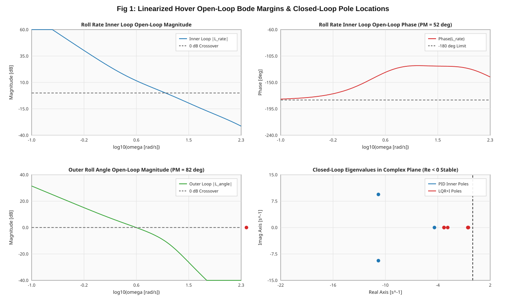
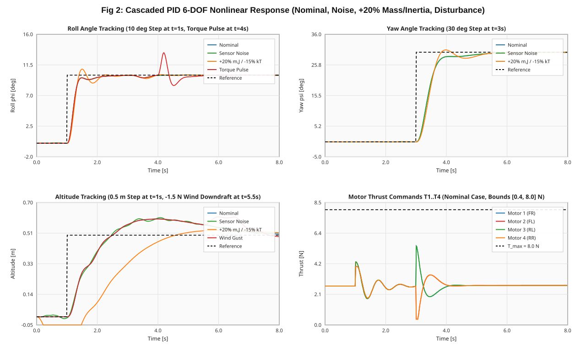
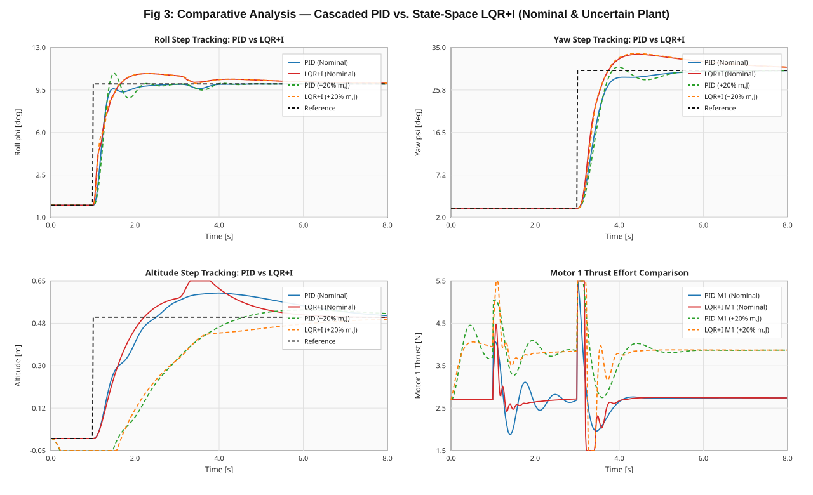

# Quadcopter Modelling, Flight Control, and Experimental Validation
[](PS11.pdf)
[](firmware/quad_fc/)
[](firmware/quad_fc/)
[](matlab/)

Complete end-to-end laboratory project for **EE302 Control Systems**: mathematical modelling, non-linear 6-DOF simulation, analytical gain synthesis (Cascaded PID vs. LQR+I), firmware implementation on an Arduino Mega 2560 + ESP8266 combo board, live Wi-Fi ground station, and hardware validation on an F450 tethered flight rig.

---

## 📑 Table of Contents
1. [Project Overview](#project-overview)
2. [Hardware Architecture](#hardware-architecture)
3. [Mathematical Modelling & Control Design](#mathematical-modelling--control-design)
4. [Simulation Suite & Results](#simulation-suite--results)
5. [Firmware & Safety Architecture](#firmware--safety-architecture)
6. [Ground Station & Wi-Fi Telemetry](#ground-station--wi-fi-telemetry)
7. [Directory Structure](#directory-structure)
8. [Getting Started & Reproduction](#getting-started--reproduction)

---

## 1. Project Overview

The project aims to design and experimentally validate an attitude and altitude stabilization system for an X-configuration quadcopter.
- **Translational and rotational equations of motion** derived using Newton-Euler formulation with first-order actuator lag ($\tau_m = 50\text{ ms}$) and aerodynamic drag.
- **Cascaded PID Control Loop**: High-rate inner angular rate PID ($200\text{ Hz}$) coupled with outer attitude angle P control, plus vertical altitude tracking with hover feedforward and tilt compensation.
- **Comparative State-Space LQR+I**: Full-state feedback controller with integral augmentation synthesized via Continuous Algebraic Riccati Equation (CARE).
- **Embedded Implementation**: Lightweight, robust C++ flight controller on an Arduino Mega 2560 with auto-detecting IMU drivers (Adafruit BNO085 / BNO055 / MPU6050) and dual-channel communication (USB + onboard ESP8266 Serial3).
- **Safety & Ground Control**: Interactive browser-based mobile/desktop Ground Station serving real-time 50 Hz telemetry, hardware kill-switch, and bench tests.

---

## 2. Hardware Architecture

<p align="center">
  
  
</p>

### Key Components:
- **Frame**: F450 quadcopter frame ($L = 0.225\text{ m}$ arm length, $d = 0.1591\text{ m}$ moment arm).
- **Motors & ESCs**: 4x A2212/13T 1000KV brushless motors with 30A ESCs, powered via central PDB from a 3S LiPo / bench DC power supply.
- **Flight Controller**: Arduino Mega 2560 + ESP8266 combo board (RobotDyn Mega+WiFi R3).
- **IMU**: Adafruit BNO085 9-DoF sensor via I2C (`0x4A`, Mega pins 20=SDA, 21=SCL) delivering 100 Hz quaternion attitude and angular rates.
- **Actuator Pinout**:
  - `Motor 0` (Front-Right, CW): **PWM Pin 9**
  - `Motor 1` (Front-Left, CCW): **PWM Pin 8**
  - `Motor 2` (Rear-Left, CW): **PWM Pin 7**
  - `Motor 3` (Rear-Right, CCW): **PWM Pin 6**
  - Ground: Shared common ground via Mega `POWER` GND header.

> **Safety Note on ESC BEC (+5V)**: The middle red wire (+5V BEC) of the ESCs is left disconnected from the Mega to prevent back-powering the laptop's USB 5V rail.

---

## 3. Mathematical Modelling & Control Design

### 3.1 6-DOF Nonlinear Newton-Euler Model
The state vector $\mathbf{x} \in \mathbb{R}^{16}$ is defined as:
$$\mathbf{x} = \begin{bmatrix} \mathbf{p}^E & \mathbf{v}^E & \boldsymbol{\eta} & \boldsymbol{\omega}^B & \mathbf{T} \end{bmatrix}^T$$
where $\mathbf{p}^E = [x, y, z]^T$, $\mathbf{v}^E = [u, v, w]^T$, $\boldsymbol{\eta} = [\phi, \theta, \psi]^T$ (Euler angles), $\boldsymbol{\omega}^B = [p, q, r]^T$ (body rates), and $\mathbf{T} = [T_1, T_2, T_3, T_4]^T$ (motor thrusts).

$$\dot{\mathbf{v}}^E = \begin{bmatrix} 0 \\ 0 \\ g \end{bmatrix} + \mathbf{R}_{B}^E(\boldsymbol{\eta}) \begin{bmatrix} 0 \\ 0 \\ -\frac{\sum T_i}{m} \end{bmatrix} - \frac{c_d}{m}\mathbf{v}^E + \frac{\mathbf{f}_{ext}}{m}$$
$$\mathbf{J}\dot{\boldsymbol{\omega}}^B = \boldsymbol{\tau}^B - \boldsymbol{\omega}^B \times (\mathbf{J}\boldsymbol{\omega}^B)$$
$$\dot{T}_i = \frac{T_{cmd, i} - T_i}{\tau_m}$$

### 3.2 Control Synthesis (Cascaded PID vs. LQR+I)
- **Inner Loop (Rate PID)**:
  $$u_{\tau} = K_p (r_{sp} - r) + K_i \int (r_{sp} - r)dt + K_d \frac{d}{dt}(r_{filt})$$
  - Designed with rate crossover $\omega_r \approx 15\text{ rad/s}$ yielding Phase Margin $\approx 57.1^\circ$.
- **Outer Loop (Attitude P)**:
  $$r_{sp} = K_{ang} (\eta_{ref} - \eta), \quad K_{ang} = \frac{\omega_r}{4} = 3.75\text{ s}^{-1}$$
  - Open-loop crossover $\approx 4.6\text{ rad/s}$, Phase Margin $\approx 72.1^\circ$, Gain Margin $= 14.3\text{ dB}$.
- **Firmware Equivalent Gains**:
  - $K_{ang} = 3.75$, $K_{p, rate} = 0.5656$, $K_{i, rate} = 0.50$, $K_{d, rate} = 0.0113$.

---

## 4. Simulation Suite & Results

### Figure 1: Linear Stability & Frequency Domain
Open-loop Bode margins and pole-zero locations confirming all closed-loop eigenvalues lie strictly in the stable left-half complex plane:


### Figure 2: Cascaded PID Across All PS11 Scenarios
Full 6-DOF nonlinear tracking under nominal conditions, sensor noise, $+20\%$ mass/inertia & $-15\%$ thrust uncertainty, and roll torque pulse:


### Figure 3: Comparative Analysis — Cascaded PID vs. LQR+I
Side-by-side benchmark of Cascaded PID against state-space LQR with integral action under actuator saturation and plant variations:


### Performance Metrics Summary

| Scenario | Axis | Overshoot (%) | Rise Time (s) | 2% Settling (s) | 5% Settling (s) | Steady-State Error | RMSE |
| :--- | :--- | :---: | :---: | :---: | :---: | :---: | :---: |
| **PID Nominal** | Roll ($10^\circ$) | **0.00%** | 0.272 s | 2.751 s | 0.877 s | 0.0000° | 1.538 |
| **PID Nominal** | Yaw ($30^\circ$) | **0.00%** | 0.590 s | 2.186 s | 1.001 s | 0.0239° | 7.364 |
| **PID Nominal** | Alt ($0.5\text{ m}$) | 19.88% | 0.993 s | 6.695 s | 5.849 s | -0.0108 m | 0.130 |
| **PID Noisy** | Roll ($10^\circ$) | 0.42% | 0.274 s | 2.769 s | 0.887 s | 0.0117° | 1.540 |
| **PID +20% m,J** | Roll ($10^\circ$) | 8.83% | 0.239 s | 2.842 s | 2.623 s | 0.0000° | 1.637 |
| **PID Disturbance**| Roll ($10^\circ$) | 32.97% | 0.272 s | 4.193 s | 3.794 s | 0.0008° | 1.634 |
| **LQR Nominal** | Roll ($10^\circ$) | 8.55% | 0.414 s | 4.805 s | 2.187 s | -0.0738° | 1.414 |
| **LQR Nominal** | Yaw ($30^\circ$) | 11.79% | 0.446 s | 4.999 s | 3.518 s | -0.8232° | 6.911 |

---

## 5. Firmware & Safety Architecture

The firmware is located in [`firmware/quad_fc/`](firmware/quad_fc/):
- **Core Loop**: Deterministic $200\text{ Hz}$ execution (`LOOP_US = 5000 µs`).
- **Safety Interlocks**:
  - Arming refused if throttle $\ge 1050\ \mu\text{s}$, vehicle tilt $> 20^\circ$, or IMU unavailable.
  - Automatic emergency disarm if tilt exceeds $55^\circ$.
  - 1000 ms watchdog timeout: auto-disarms if telemetry/PING connection drops.
- **I2C Bus Recovery**: Built-in 16-clock SCL pulse recovery (`i2c_bus_recover`) and hardware bus timeout (`Wire.setWireTimeout(25000, true)`), immune to cable vibration disconnects.
- **Dual Serial Routing**: Simultaneously processes commands from USB Serial and ESP8266 `Serial3`.

---

## 6. Ground Station & Wi-Fi Telemetry

The repository includes a web-based ground station in [`tools/wifi_ground_station.py`](tools/wifi_ground_station.py):
- Serves an interactive mobile-friendly web UI over local Wi-Fi / hotspot at `http://<laptop-ip>:8080`.
- Provides an immediate **Spacebar / Big Red Button EMERGENCY STOP**.
- Live 50 Hz attitude stream, motor PWM bars, and one-click diagnostic tools (`SCAN`, `Zero Level (CAL)`, props-off `ESC_TEST`).
- Logs CSV telemetry directly to `logs/` for post-flight MATLAB validation.

---

## 7. Directory Structure

```text
quadcopter/
├── docs/
│   └── images/                    # Hardware photos & wiring diagrams
├── firmware/
│   └── quad_fc/
│       ├── config.h               # Physical parameters, mixer matrix, PID gains
│       └── quad_fc.ino            # 200 Hz flight controller (C++/Arduino)
├── matlab/
│   ├── params.m                   # Physical quadcopter constants
│   ├── quad_dynamics.m            # 16-state nonlinear equations of motion
│   ├── design_gains.m             # Analytical PID & CARE LQR synthesis
│   ├── linearize_quad.m           # Linear state-space model & Bode stability
│   ├── sim_quad.m                 # RK4 closed-loop dynamic simulator
│   ├── compute_metrics.m          # Rise time, overshoot, settling, RMSE
│   ├── run_all_sims.m             # Master script generating results
│   ├── build_simulink_model.m     # Programmatic Simulink model builder (.slx)
│   ├── analyse_flight_logs.m      # Hardware telemetry vs simulation validation
│   └── results/                   # Generated high-res plots and metrics CSV
├── logs/                          # Flight logs and sample telemetry
├── tools/
│   ├── generate_results.py        # Independent cross-check simulator & plot exporter
│   ├── check_sim.py               # Minimal Python ODE solver verification
│   ├── probe_serial.py            # Serial port and IMU diagnostics tool
│   └── wifi_ground_station.py     # Mobile/desktop web ground station server
├── backup/                        # Factory firmware binary and restore scripts
├── PROJECT_STATUS.md              # Living engineering status & experiment log
├── PS11.pdf                       # Problem Statement & project requirements
└── README.md
```

---

## 8. Getting Started & Reproduction

### Running Simulations in MATLAB / Octave
1. Open MATLAB and navigate to the project directory:
   ```matlab
   cd matlab
   run_all_sims
   ```
2. To build and open the Simulink block diagram:
   ```matlab
   build_simulink_model
   ```

### Running Simulations on Linux (Without MATLAB)
An independent Python cross-check solver generates identical metrics and plots:
```bash
python3 tools/generate_results.py
```

### Flashing Firmware to Arduino Mega 2560
Using `arduino-cli`:
```bash
arduino-cli compile --fqbn arduino:avr:mega firmware/quad_fc
arduino-cli upload -p /dev/ttyUSB0 --fqbn arduino:avr:mega firmware/quad_fc
```

### Launching Ground Station
```bash
python3 tools/wifi_ground_station.py
```
Open `http://localhost:8080` (or `http://<your-ip>:8080` on your mobile browser).

---

## 👥 Authors & Acknowledgments
- Control System Design, Embedded Firmware, and Hardware Validation for **EE302 Control Systems Laboratory**.
